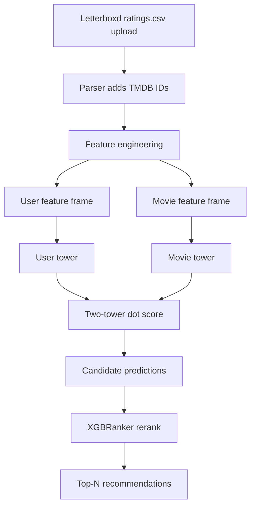

# Letterboxd AI Movie Recommender

A hybrid movie recommender built from Letterboxd CSV exports and TMDB/MovieLens-derived features.

The latest pipeline uses a two-stage ranking flow:

1. A two-tower neural network retrieves candidate movie scores from user and movie embeddings.
2. An `XGBRanker` reranks those candidates using enriched user, movie, and retrieval features.

Users upload their Letterboxd ratings CSV and receive a ranked list of 10 movies.

---

## Current Pipeline



### What `src/recommender/hybrid_test.py` does now

- Loads the filtered Letterboxd sample data and TMDB links.
- Reconstructs user and movie features from the saved Parquet files.
- Loads saved `user_embeddings_nn.parquet` and `movie_embeddings_nn.parquet`.
- Normalizes both embedding vectors and computes the two-tower retrieval score.
- Builds `candidate_preds` with enriched features.
- Applies `XGBRanker` as the final reranking stage.
- Produces the ranked recommendation tables used for evaluation.

---

## Model Stack

### Two-Tower Retrieval Model

The retrieval model is the saved Keras two-tower network in `models/two_tower.keras`.

- User tower: dense projection to a 32-dimensional embedding.
- Movie tower: dense projection to a 32-dimensional embedding.
- Final scoring: L2-normalize both tower outputs, then take the dot product.
- Target scaling: the rating target is stored with `MinMaxScaler((-1, 1))` in `models/scaler_y.pkl`.

Important detail: the saved embedding Parquet files contain the raw tower outputs, not the normalized vectors used by the final dot-product scorer.

### Final Reranker

The final ranking stage is `XGBRanker`.

- It consumes the candidate set produced by the two-tower stage.
- It reranks movies using the enriched features below.
- It is the latest final-stage model used by the project.

---

## Enriched Features

### User Features

- `user_Action`
- `user_Adventure`
- `user_Animation`
- `user_Children`
- `user_Comedy`
- `user_Crime`
- `user_Documentary`
- `user_Drama`
- `user_Fantasy`
- `user_Film-Noir`
- `user_Horror`
- `user_IMAX`
- `user_Musical`
- `user_Mystery`
- `user_Romance`
- `user_Sci-Fi`
- `user_Thriller`
- `user_War`
- `user_Western`
- `user_Decade_1890.0` through `user_Decade_2020.0`
- `user_avg_rating`
- `user_std_rating`
- `user_count_rating`

### Movie Features

- `movie_Action`
- `movie_Adventure`
- `movie_Animation`
- `movie_Children`
- `movie_Comedy`
- `movie_Crime`
- `movie_Documentary`
- `movie_Drama`
- `movie_Fantasy`
- `movie_Film-Noir`
- `movie_Horror`
- `movie_IMAX`
- `movie_Musical`
- `movie_Mystery`
- `movie_Romance`
- `movie_Sci-Fi`
- `movie_Thriller`
- `movie_War`
- `movie_Western`
- `movie_Release_Year`
- `movie_title_clean`
- `movie_avg_rating`
- `movie_Decade_1890.0` through `movie_Decade_2020.0`
- `movie_tmdb_0` through `movie_tmdb_31`
  - 32-dimensional TMDB embedding block

### Hybrid / Ranking Features

- `predicted_rating`
- `user_rank`
- `z_score`
- `genre_affinity`
- `decade_affinity`
- `Original_Language_affinity`
- `Origin_country_affinity`
- `Director_affinity`
- `Top_cast_affinity`
- `Keyword_affinity`
- `Overview_affinity`
- `Production_company_affinity`
- `vote_count_affinity`
- `vote_average_affinity`
- `revenue_affinity`

The enriched affinities are calculated in Notebook 3 from train-only user ratings.
Categorical and overview affinities average the user's historical rating preference
for matching tokens, while numeric affinities measure the distance from the user's
rating-weighted preference after skew correction and standardization.

---

# 🛠️ Tech Stack

## Frontend / UI

- Next.js
- React
- TypeScript
- Tailwind CSS

## Core ML Stack

- Python
- Pandas
- NumPy
- TensorFlow / Keras
- XGBoost
- Scikit-learn
- Jupyter notebooks

## Data Sources

- Letterboxd CSV exports
- MovieLens 32M
- TMDB metadata and link tables

---

## Project Structure

```text
letterboxd-rec/
├── data/
├── frontend/
├── models/
├── notebooks/
├── pipeline/
├── src/
│   └── recommender/
└── README.md
```

---

## Getting Started

### Prerequisites

- Python 3.11-3.13 (TensorFlow does not provide a Python 3.14 wheel)
- Git
- Node.js and npm for the frontend

### Local Run

```powershell
git clone https://github.com/yourusername/letterboxd-rec.git
cd letterboxd-rec
python -m venv venv
venv\Scripts\activate
pip install -r requirements.txt
```

Start the API from the project root:

```powershell
uvicorn backend.main:app --reload
```

Then start the upload UI in another terminal:

```powershell
cd frontend
npm install
npm run dev
```

Upload the `ratings.csv` from a Letterboxd data export. The Python parser maps
up to 10 films concurrently, reuses `data/letterboxd/cache.json`, and passes
the matched TMDB IDs and ratings into the hybrid recommender.

---

## Evaluation

Recommendation quality is currently checked with ranking metrics such as:

- RMSE for score calibration
- NDCG@20 for ranked recommendation quality
- Precision@K / Recall@K for retrieval quality

---

## Implementation Plan

### Current

- File-based inference and evaluation from saved CSV, Parquet, and model artifacts.
- Two-tower retrieval followed by `XGBRanker` reranking.
- Enriched user and movie feature frames stored in `data/`.

### Next

- Wrap the hybrid pipeline behind a clean application entrypoint.
- Keep the final rerank stage on `XGBRanker`.
- Reduce import-time side effects in the recommender utilities.
- Add a lightweight UI or demo that reads from the saved artifacts.

---

## Project Goal

Build a personalised movie discovery workflow that combines a two-tower retrieval model with an `XGBRanker` reranker, using enriched Letterboxd and TMDB features without requiring a database.
